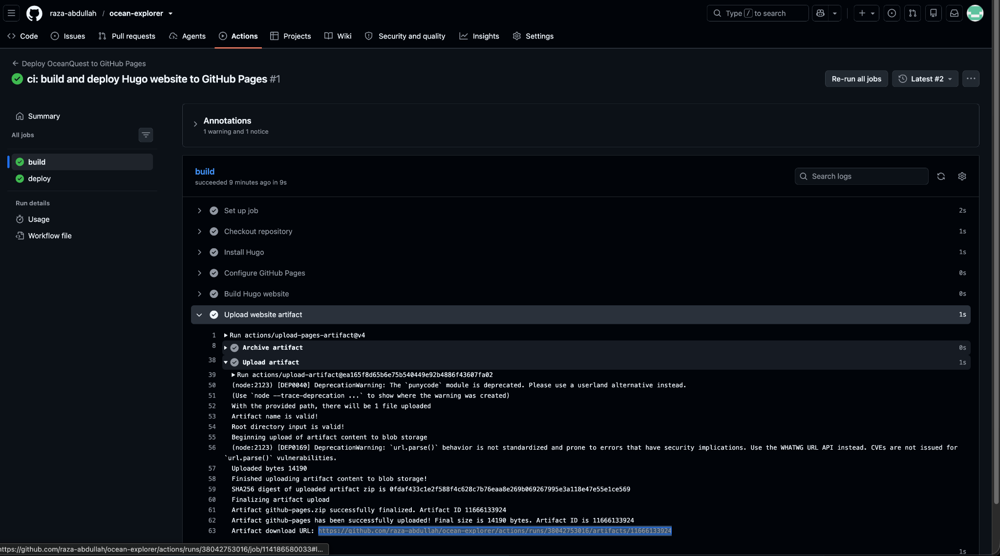

# 🌊 OceanQuest — The Secret World Under the Ocean

**Dive deep. Discover wonders. Explore our Blue Planet. 🐠**

[🌐 Explore the live website](https://raza-abdullah.github.io/ocean-explorer/) · [📂 Source code](https://github.com/raza-abdullah/ocean-explorer) · [⚙️ GitHub Actions](https://github.com/raza-abdullah/ocean-explorer/actions)

OceanQuest is an interactive, geography-focused ocean adventure created for a school website-building competition. Explore marine life, ocean ecosystems, the hidden landscape of the seafloor, latitude and longitude, and the importance of protecting our oceans.

The project is also a story about **learning to build with AI**: asking questions, comparing technologies, improving ideas, troubleshooting problems, and testing the results.

> **School presentation:** The finished site is designed to work without Wi-Fi. The website is built in advance and can be carried to school on a USB drive.

## 🧭 Explore OceanQuest

| Adventure | What you'll discover |
| --- | --- |
| 🌍 Our Blue Planet | Oceans, continents, hemispheres, and Earth's watery surface |
| 🧭 Ocean Explorer's GPS | Latitude, longitude, and real underwater locations |
| 🏔️ Ocean vs. Land | Everest versus Challenger Deep, seamounts, and ocean trenches |
| 🤿 Dive Into the Deep | The Sunlight, Twilight, Midnight, Abyssal, and Hadal zones |
| 🐙 Meet the Marine Life | Creatures, habitats, and surprising adaptations |
| 🪸 Ocean Ecosystems | Coral reefs, kelp forests, and deep-ocean communities |
| ♻️ Become an Ocean Guardian | Why the oceans matter and how we can protect them |
| 🏆 Ocean Explorer Challenge | Interactive questions and learning activities |
| 🤖 My AI Build Journey | How the idea became a working website with ChatGPT's help |

## ✨ Highlights

- Ocean-inspired visuals, local illustrations, and interactive learning activities.
- Geography and science explained with comparisons, questions, and discoveries.
- Responsive layout for desktop and tablet browsers.
- **No online services required to view the built website** when its local assets and links are used.
- Hugo-generated static HTML, CSS, and JavaScript, with no runtime database.
- A behind-the-scenes AI journey that documents real design decisions and debugging.

## 🛠️ Technology

| Technology | Role |
| --- | --- |
| [Hugo](https://gohugo.io/) | Static site generation |
| Markdown and Hugo templates | Educational content and reusable layout |
| HTML5 + CSS3 | Page structure, styling, and animations |
| Vanilla JavaScript | Interactive activities and quizzes |
| SVG and other local images | Ocean illustrations and visual content |
| GitHub Actions | Automated build and GitHub Pages deployment |
| ChatGPT | AI-assisted ideation, implementation, explanations, and debugging |

## 🚀 Develop locally

### Requirements

Install [Hugo](https://gohugo.io/installation/). On macOS with Homebrew:

```bash
brew install hugo
hugo version
```

Clone and run:

```bash
git clone https://github.com/raza-abdullah/ocean-explorer.git
cd ocean-explorer
hugo server
```

Visit **http://localhost:1313/**. Hugo watches for edits and rebuilds the development site.

### Build the static website

```bash
hugo --cleanDestinationDir
```

The output is in **`public/`**. You can inspect it locally, then copy it to a USB drive. The Hugo development server is **not** required on the school computer.

## ⚙️ GitHub Actions: build, deploy, and download artifacts

Every push to `main` triggers the [GitHub Actions workflow](https://github.com/raza-abdullah/ocean-explorer/actions), which builds the Hugo site and deploys it to GitHub Pages.

### How to find the build artifact

1. Open the repository's **[Actions](https://github.com/raza-abdullah/ocean-explorer/actions)** tab.
2. Select the latest successful **Deploy OceanQuest to GitHub Pages** run (look for the green check mark).
3. Open the **build** job and expand **Upload website artifact** to confirm that the upload succeeded, as shown below.
4. Return to the **workflow run Summary** page and scroll to **Artifacts**. Select **`github-pages`** to download it, if GitHub makes it available to your account and the artifact has not expired.
5. The downloaded GitHub Pages artifact may contain an **`artifact.tar`** archive rather than a directly browsable website. Extract the archive before using its contents. If you want the simplest USB-ready output, use the **local Hugo build** described below instead.



*Screenshot: a successful `build` job and artifact upload. The download link is found on the workflow run's Summary page under Artifacts, not inside this log.*

**Note:** GitHub Pages deployment artifacts are designed for the deployment workflow. They can expire, and artifact download permissions depend on GitHub access. A local `hugo` build is the recommended way to prepare the school USB drive.

## 💾 Prepare the school USB drive (recommended)

1. On your development computer, run `hugo --cleanDestinationDir` in the repository root.
2. Create a folder named `OceanQuest` on the USB drive.
3. Copy **everything inside `public/`** into `OceanQuest/`, including HTML, CSS, JavaScript, and images.
4. Disconnect the internet and open `OceanQuest/index.html` in Chrome or Edge.
5. Test navigation, images, interactive activities, and the **My AI Build Journey** page before the presentation.

Example USB layout:

```text
USB-DRIVE/
└── OceanQuest/
    ├── index.html
    ├── ai-journey.html
    ├── css/
    ├── js/
    └── images/
```

The exact generated files may differ as the project evolves. **Copy the entire output, not only `index.html`.**

> **Offline checklist:** Test from the actual USB drive with Wi-Fi turned off. Avoid external fonts, CDNs, remote images, online maps, and browser `fetch()` calls to local files. Successful GitHub Pages deployment alone does not prove `file://` compatibility.

## 🤖 My AI Build Journey

The project began with a question: *How can I build a school website that works without the internet?*

We explored HTML, Markdown, and several static site generators. ChatGPT initially suggested Eleventy; after comparing it with Hugo and discussing the image-rich design, we chose **Hugo**. Then the ocean theme grew into an interactive geography adventure with depth zones, latitude and longitude, marine ecosystems, and quizzes.

Along the way, AI helped us:

1. **Explore options:** Compare website technologies and offline deployment approaches.
2. **Shape the idea:** Turn an ocean theme into a geography and marine-science adventure.
3. **Build features:** Generate and improve templates, CSS, and JavaScript.
4. **Solve problems:** Investigate GitHub Pages setup issues and Hugo deprecation warnings.
5. **Keep improving:** Add new educational experiences and reflect on what worked.

**The lesson:** AI is a learning and problem-solving partner. The important skills are asking useful questions, checking suggestions, understanding changes, and testing the finished work.

### 👋 Meet the Young Explorer

**Abdullah Raza** · **Grade 6** · **New Middle East International School**

OceanQuest combines a curiosity about our Blue Planet with the challenge of building a real website using AI assistance.

*Privacy note: This repository is public. The student and parent/guardian should be comfortable with displaying the student's name and school online.*

## 🎯 What visitors can learn

- Why oceans cover about **71%** of Earth's surface.
- How **latitude and longitude** identify places on Earth.
- How underwater mountains, trenches, and ridges compare with landforms.
- How ocean **light, temperature, and pressure** change with depth.
- How marine creatures and ecosystems adapt to different environments.
- Why protecting oceans matters for life on land as well as underwater.

## 📚 Learn more

Explore reliable ocean and geography resources:

- [NOAA Ocean Service](https://oceanservice.noaa.gov/)
- [NOAA Ocean Exploration](https://oceanexplorer.noaa.gov/)
- [NASA Earth Observatory](https://earthobservatory.nasa.gov/)
- [UNESCO Ocean](https://www.unesco.org/en/ocean)

---

**Explore the ocean. Discover its secrets. Protect its future. 🌊**
